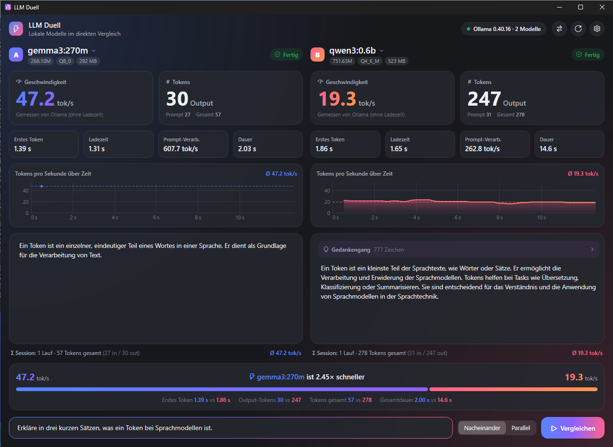

# LLM Duell

**Zwei lokale Sprachmodelle, ein Prompt – wer ist schneller?**

LLM Duell ist eine native App für **macOS** und **Windows**, die zwei über [Ollama](https://ollama.com) installierte Modelle mit demselben Prompt gegeneinander antreten lässt und dabei live misst, wie viele Tokens pro Sekunde sie erzeugen und wie viele Tokens insgesamt verbraucht werden.

| macOS | Windows |
| --- | --- |
|  |  |

## Funktionen

- **Live-Geschwindigkeit** in Tokens pro Sekunde während der Generierung, am Ende ersetzt durch den exakten Wert von Ollama (ohne Ladezeit)
- **Token-Zähler** für Output, Prompt und Gesamt – pro Lauf und aufsummiert über die Session
- **Zeit bis zum ersten Token**, Ladezeit des Modells, Prompt-Verarbeitung und Gesamtdauer
- **Verlaufsdiagramm** der Tokens pro Sekunde, für beide Modelle auf gemeinsamen Achsen
- **Vergleichsleiste**, die zeigt, welches Modell wie viel schneller ist
- **Nacheinander oder parallel**: nacheinander misst fairer, parallel spart Zeit
- Temperatur, fester Seed und System-Prompt einstellbar; Gedankengang von Reasoning-Modellen (z. B. qwen3, deepseek-r1) wird separat angezeigt
- Heller und dunkler Modus, passend zur Einstellung des Systems

## Installation

Auf beiden Systemen brauchst du zuerst Ollama und mindestens ein Modell – für einen Vergleich am besten zwei:

1. [Ollama](https://ollama.com/download) herunterladen und installieren.
2. Im Terminal (macOS) bzw. in der Eingabeaufforderung oder PowerShell (Windows) Modelle laden, z. B.
   ```bash
   ollama pull gemma3
   ollama pull llama3.2
   ```

Danach installierst du LLM Duell. Alle Downloads findest du unter [Releases](../../releases/latest).

| System | Datei | Voraussetzung |
| --- | --- | --- |
| macOS | `LLM-Duell-x.y.z.dmg` | macOS 15 (Sequoia) oder neuer, Apple Silicon oder Intel |
| Windows (Installer) | `LLM-Duell-x.y.z-Setup.exe` | Windows 10 (ab Version 1903) oder Windows 11 |
| Windows (portabel) | `LLM-Duell-x.y.z-Windows.zip` | wie oben |

### macOS

1. `LLM-Duell-x.y.z.dmg` herunterladen und öffnen.
2. **LLM Duell** in den Ordner **Programme** ziehen.
3. Beim ersten Start blockiert macOS die App mit dem Hinweis, dass der Entwickler nicht überprüft werden kann, denn sie ist nicht von Apple notarisiert. So startest du sie trotzdem:
   1. LLM Duell einmal öffnen und den Dialog schließen.
   2. **Systemeinstellungen → Datenschutz & Sicherheit** öffnen, nach unten scrollen und bei „LLM Duell“ auf **Dennoch öffnen** klicken.

   Alternativ im Terminal:
   ```bash
   xattr -dr com.apple.quarantine "/Applications/LLM Duell.app"
   ```

Danach startet die App ganz normal.

### Windows

**Mit Installer (empfohlen)**

1. `LLM-Duell-x.y.z-Setup.exe` herunterladen und ausführen.
2. Die App ist nicht signiert. Windows zeigt deshalb beim ersten Start des Installers den Hinweis „Der Computer wurde durch Windows geschützt“. Klicke dort auf **Weitere Informationen** und dann auf **Trotzdem ausführen**. Meldet schon der Browser, die Datei werde „nicht häufig heruntergeladen“, wähle **Beibehalten**.
3. Dem Assistenten folgen. Administratorrechte sind nicht nötig; die App wird nur für dein Benutzerkonto installiert.
4. LLM Duell über das Startmenü öffnen.

Zum Entfernen: **Einstellungen → Apps → Installierte Apps → LLM Duell → Deinstallieren**.

**Portabel, ohne Installation**

1. `LLM-Duell-x.y.z-Windows.zip` herunterladen und entpacken.
2. `LLM Duell.exe` an einen beliebigen Ort legen und doppelklicken. Auch hier erscheint beim ersten Start der Hinweis von Windows: **Weitere Informationen → Trotzdem ausführen**.

Die Windows-Version besteht aus einer einzigen kleinen Datei und nutzt das .NET Framework 4.8, das in Windows bereits enthalten ist – du musst nichts weiter installieren. Deine Einstellungen liegen unter `%APPDATA%\LLM Duell\settings.json`.

### Ollama wird nicht gefunden?

Zeigt die App oben rechts „Ollama nicht erreichbar“, läuft Ollama nicht oder unter einer anderen Adresse:

- Ollama starten (macOS: App „Ollama“ öffnen, Windows: „Ollama“ im Startmenü) und in LLM Duell auf **Aktualisieren** klicken.
- Standard ist `http://localhost:11434`. Einen anderen Host oder Port trägst du in den Optionen (Zahnrad oben rechts) ein.

## Bedienung

| Aktion | macOS | Windows |
| --- | --- | --- |
| Vergleich starten | ⏎ im Prompt-Feld oder ⌘⏎ | Eingabe im Prompt-Feld oder Strg+Eingabe |
| Neue Zeile im Prompt | ⌥⏎ | Umschalt+Eingabe |
| Abbrechen | Esc oder ⌘. | Esc |
| Modelle tauschen | ⇧⌘T | Strg+Umschalt+T |
| Modellliste aktualisieren | ⌘R | F5 oder Strg+R |

### Was wird gemessen?

| Wert | Quelle |
| --- | --- |
| Tokens/s (live) | Anzahl gestreamter Chunks seit dem ersten Token, geteilt durch die vergangene Zeit – eine Schätzung |
| Tokens/s (final) | `eval_count / eval_duration` aus der Antwort von Ollama – ohne Lade- und Prompt-Zeit |
| Prompt-Verarbeitung | `prompt_eval_count / prompt_eval_duration` |
| Erstes Token | Zeit vom Absenden bis zum ersten empfangenen Token, inklusive Ladezeit |
| Ladezeit | `load_duration` – fällt nur an, wenn das Modell noch nicht im Speicher ist |

Für faire Messungen empfiehlt sich der Modus **Nacheinander**, da sich die Modelle sonst GPU und Speicher teilen.

## Selbst bauen

```bash
git clone https://github.com/sandroleid/LLM-Duell.git
cd LLM-Duell
```

### macOS

Benötigt werden die Xcode Command Line Tools (`xcode-select --install`) oder Xcode.

```bash
./build.sh          # → dist/LLM Duell.app
./build.sh --dmg    # zusätzlich dist/LLM-Duell-<Version>.dmg
```

Die Versionsnummer setzt du mit `VERSION=1.2.0 ./build.sh --dmg`. Mit einer Apple Developer ID kann das Skript die App auch signieren und notarisieren (`SIGN_IDENTITY`, `NOTARY_PROFILE`, siehe Kopf von [`build.sh`](build.sh)).

### Windows

Benötigt wird das [.NET SDK](https://dot.net/download) (Version 8 oder neuer), für den Installer zusätzlich [Inno Setup 6](https://jrsoftware.org/isdl.php).

```powershell
.\Windows\build.ps1             # → dist\LLM Duell.exe
.\Windows\build.ps1 -Package    # zusätzlich Installer und ZIP in dist\
.\Windows\Tests\smoke.ps1       # Test gegen ein simuliertes Ollama (braucht Python)
```

Die Versionsnummer setzt du mit `-Version 1.2.0`. Bei jedem Push baut und testet [GitHub Actions](.github/workflows/windows.yml) die Windows-Version; bei einem Tag wie `v1.2.0` werden Installer und ZIP automatisch an das gleichnamige Release gehängt.

### Projektstruktur

Beide Versionen teilen sich Aufbau und Messlogik, sind aber jeweils mit den Mitteln des Systems geschrieben: SwiftUI unter macOS, WPF (C#) unter Windows.

```
Sources/LLMDuell/           macOS (SwiftUI)
├── App.swift               App-Einstieg, Fenster und Menüs
├── AppModel.swift          Einstellungen, Modellliste, Ablauf des Vergleichs
├── ModelRun.swift          Messwerte und Streaming einer Seite
├── OllamaClient.swift      HTTP-Client für die Ollama-API
├── ContentView.swift       Hauptfenster und Kopfzeile
├── ModelPanel.swift        Kennzahlen, Diagramm und Ausgabe pro Modell
├── ComparisonBar.swift     Direkter Vergleich beider Modelle
├── PromptBar.swift         Eingabe und Start-Button
├── OptionsView.swift       Optionen-Popover
└── Theme.swift             Farben und gemeinsame UI-Bausteine

Windows/                    Windows (WPF, .NET Framework 4.8)
├── App.xaml                App-Einstieg, Farben und Vorlagen der Bedienelemente
├── AppModel.cs             Modellliste, Ablauf des Vergleichs
├── Core.cs                 Einstellungen, Uhr und Formatierung
├── ModelRun.cs             Messwerte und Streaming einer Seite
├── OllamaClient.cs         HTTP-Client für die Ollama-API
├── MainWindow.xaml         Hauptfenster: Kopfzeile, Vergleich, Eingabe, Optionen
├── ModelPanel.xaml         Kennzahlen, Diagramm und Ausgabe pro Modell
├── SpeedChart.cs           Verlaufsdiagramm
├── Markdown.cs             Darstellung der Antwort
├── Theme.cs                Heller und dunkler Modus
├── installer.iss           Installer (Inno Setup)
└── Tests/                  Simuliertes Ollama und automatischer Test
```

## Lizenz

LLM Duell steht unter der [GNU General Public License v3.0](LICENSE).
