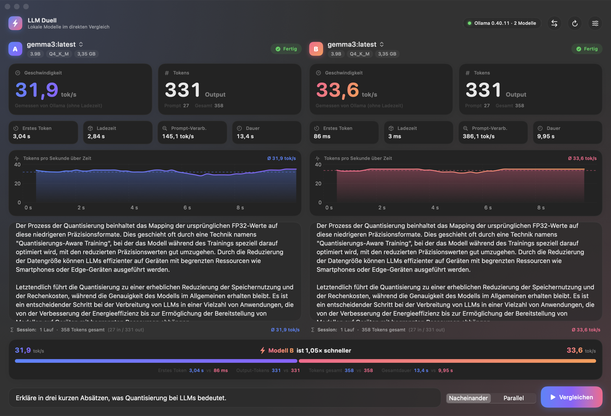

# LLM Duell

**Zwei lokale Sprachmodelle, ein Prompt – wer ist schneller?**

LLM Duell ist eine native macOS-App, die zwei über [Ollama](https://ollama.com) installierte Modelle mit demselben Prompt gegeneinander antreten lässt und dabei live misst, wie viele Tokens pro Sekunde sie erzeugen und wie viele Tokens insgesamt verbraucht werden.



## Funktionen

- **Live-Geschwindigkeit** in Tokens pro Sekunde während der Generierung, am Ende ersetzt durch den exakten Wert von Ollama (ohne Ladezeit)
- **Token-Zähler** für Output, Prompt und Gesamt – pro Lauf und aufsummiert über die Session
- **Zeit bis zum ersten Token**, Ladezeit des Modells, Prompt-Verarbeitung und Gesamtdauer
- **Verlaufsdiagramm** der Tokens pro Sekunde, für beide Modelle auf gemeinsamen Achsen
- **Vergleichsleiste**, die zeigt, welches Modell wie viel schneller ist
- **Nacheinander oder parallel**: nacheinander misst fairer, parallel spart Zeit
- Temperatur, fester Seed und System-Prompt einstellbar; Gedankengang von Reasoning-Modellen (z. B. qwen3, deepseek-r1) wird separat angezeigt
- Heller und dunkler Modus, Universal-App für Apple Silicon und Intel

## Installation

1. [Ollama](https://ollama.com/download) installieren und mindestens ein Modell laden, z. B.
   ```bash
   ollama pull gemma3
   ollama pull llama3.2
   ```
2. Die neueste `LLM-Duell-x.y.z.dmg` unter [Releases](../../releases/latest) herunterladen.
3. DMG öffnen und **LLM Duell** in den Ordner **Programme** ziehen.

### Erster Start

Die App ist nicht von Apple notarisiert. macOS blockiert sie deshalb beim ersten Öffnen mit dem Hinweis, dass der Entwickler nicht überprüft werden kann. So startest du sie trotzdem:

1. LLM Duell einmal öffnen und den Dialog schließen.
2. **Systemeinstellungen → Datenschutz & Sicherheit** öffnen, nach unten scrollen und bei „LLM Duell“ auf **Dennoch öffnen** klicken.

Alternativ im Terminal:

```bash
xattr -dr com.apple.quarantine "/Applications/LLM Duell.app"
```

Danach startet die App ganz normal.

## Voraussetzungen

- macOS 15 (Sequoia) oder neuer
- Ollama läuft lokal (Standard: `http://localhost:11434`). Ein anderer Host lässt sich in den Optionen (⚙︎) eintragen.

## Bedienung

| Aktion | Tastenkürzel |
| --- | --- |
| Vergleich starten | ⏎ im Prompt-Feld oder ⌘⏎ |
| Neue Zeile im Prompt | ⌥⏎ |
| Abbrechen | Esc oder ⌘. |
| Modelle tauschen | ⇧⌘T |
| Modellliste aktualisieren | ⌘R |

### Was wird gemessen?

| Wert | Quelle |
| --- | --- |
| Tokens/s (live) | Anzahl gestreamter Chunks seit dem ersten Token, geteilt durch die vergangene Zeit – eine Schätzung |
| Tokens/s (final) | `eval_count / eval_duration` aus der Antwort von Ollama – ohne Lade- und Prompt-Zeit |
| Prompt-Verarbeitung | `prompt_eval_count / prompt_eval_duration` |
| Erstes Token | Zeit vom Absenden bis zum ersten empfangenen Token, inklusive Ladezeit |
| Ladezeit | `load_duration` – fällt nur an, wenn das Modell noch nicht im Speicher ist |

Für faire Messungen empfiehlt sich der Modus **Nacheinander**, da sich die Modelle sonst GPU und Speicher teilen.

## Selbst bauen

Benötigt werden die Xcode Command Line Tools (`xcode-select --install`) oder Xcode.

```bash
git clone https://github.com/sandroleid/llm-duell.git
cd llm-duell
./build.sh          # → dist/LLM Duell.app
./build.sh --dmg    # zusätzlich dist/LLM-Duell-<Version>.dmg
```

Die Versionsnummer setzt du mit `VERSION=1.1.0 ./build.sh --dmg`. Mit einer Apple Developer ID kann das Skript die App auch signieren und notarisieren (`SIGN_IDENTITY`, `NOTARY_PROFILE`, siehe Kopf von [`build.sh`](build.sh)).

### Projektstruktur

```
Sources/LLMDuell/
├── App.swift            App-Einstieg, Fenster und Menüs
├── AppModel.swift       Einstellungen, Modellliste, Ablauf des Vergleichs
├── ModelRun.swift       Messwerte und Streaming einer Seite
├── OllamaClient.swift   HTTP-Client für die Ollama-API
├── ContentView.swift    Hauptfenster und Kopfzeile
├── ModelPanel.swift     Kennzahlen, Diagramm und Ausgabe pro Modell
├── ComparisonBar.swift  Direkter Vergleich beider Modelle
├── PromptBar.swift      Eingabe und Start-Button
├── OptionsView.swift    Optionen-Popover
└── Theme.swift          Farben und gemeinsame UI-Bausteine
```

## Lizenz

LLM Duell steht unter der [GNU General Public License v3.0](LICENSE).
